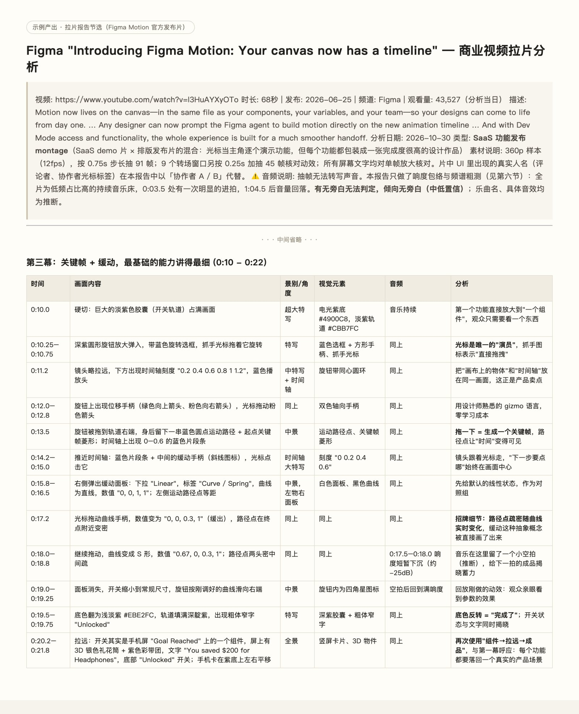

# video-lapian：把一支广告片逐秒拆开

看到一支做得好的广告、宣传片或产品发布视频，想知道它每一秒在做什么、为什么这样做、自己能借鉴什么。把链接或文件交给这个 skill，它会下载视频、抽帧，然后写出一份逐秒拉片报告。

## 示例

拉的是 Figma 官方发布片《Introducing Figma Motion》（68 秒）。下图是报告开头和第三幕的逐秒镜头表，屏幕上的曲线数值、界面文字都放大单帧核对过。

完整报告：[examples/figma-motion-report.md](examples/figma-motion-report.md)



## 适合什么时候用

- 拉片，或逐秒分析一支广告
- 做竞品视频分析
- 自己要做产品视频，想先研究一支参考片

## 你会拿到什么

一份中文报告（需要英文可以说明）：

- **逐秒镜头表**：时间、画面内容、景别和角度、视觉元素、音频、分析
- **九节分析**：产品展示策略、视觉设计语言、节奏与信息密度、场景与人物、音乐与声音、文案策略、转场、情绪曲线、可复用的脚本模板

最后一节可复用模板通常最有用，可以直接套到自己的片子上。

## 准确性

- 画面描述全部来自实际抽出的帧。屏幕上的参数、价格、口号会放大单帧逐字核对。
- 它听不到声音。旁白和音乐无法转写时，会标注为推断并给出可信度，不会编造台词或歌词。

## 需要准备

Python 3，以及：

```bash
pip3 install yt-dlp opencv-python-headless numpy
```

不需要 ffmpeg。YouTube 链接和本地视频文件都可以。

## 怎么用

- 「拉片 https://www.youtube.com/watch?v=...」
- 「分析一下这支发布视频，我想做一支类似的」

## 配套 skill

- [lapian-to-prompt](https://github.com/Minerva67/lapian-to-prompt)：把拉片报告转成能复刻这支片的生成提示词

## 包含的文件

- `SKILL.md`
- `scripts/get_video.sh`：下载视频，读取标题、时长、频道等信息
- `scripts/extract_frames.py`：按间隔抽帧，拼成带时间戳的拼图
- `references/output-template.md`：报告结构
- `references/method-notes.md`：抽帧间隔怎么选、不同类型视频的分析重点
- `examples/`：示例产出和截图

## 安装

```bash
git clone https://github.com/Minerva67/video-lapian.git ~/.claude/skills/video-lapian
```

重启 Claude Code 后，直接描述你的任务就会触发。也可以输入 `/video-lapian` 手动调用。

更多 skill 见 [claude-skills](https://github.com/Minerva67/claude-skills)。

## 许可证

MIT
